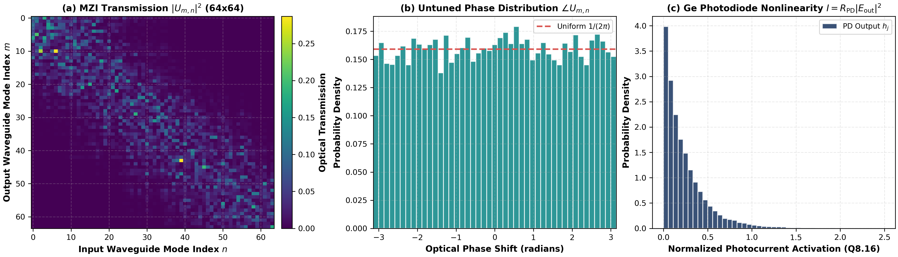
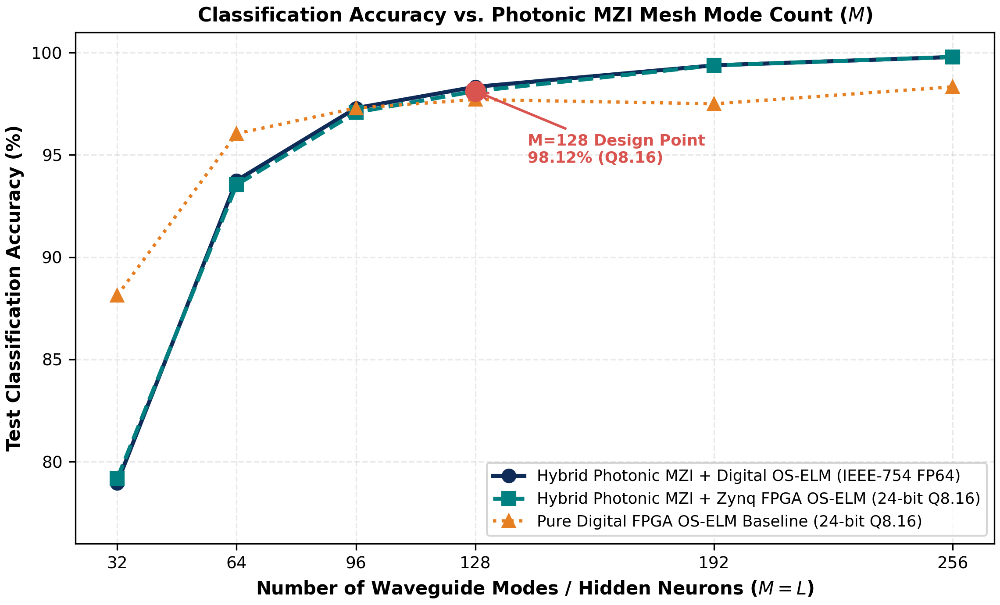
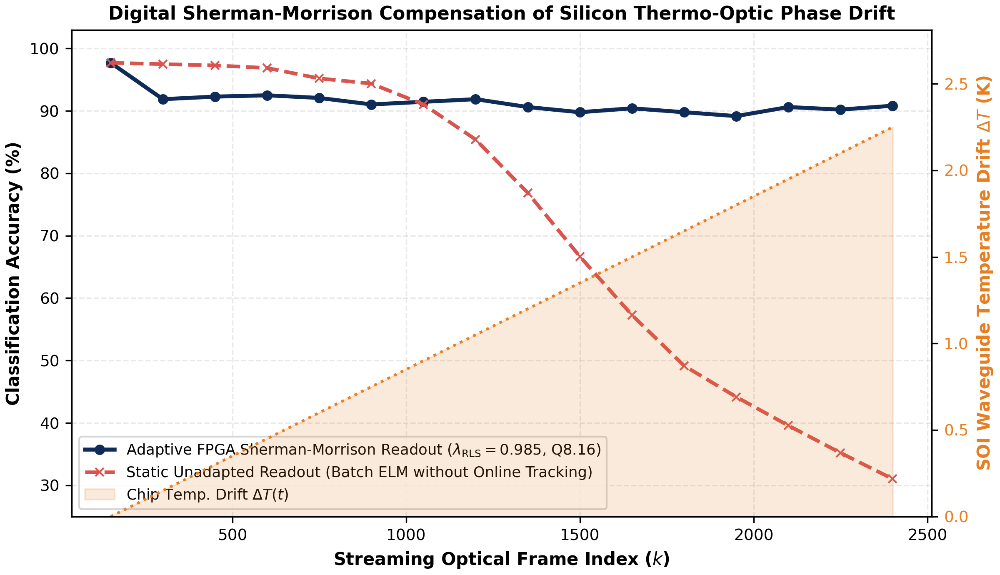
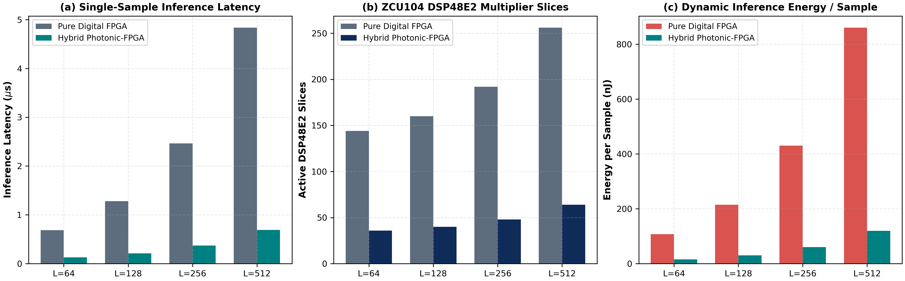

# Hybrid Photonic-Digital OS-ELM Accelerator: Passive MZI Mesh & FPGA Co-Design

**Author:** Harsh Patel  
**Target Architecture:** 220 nm Silicon-on-Insulator (SOI) Passive Clements MZI Mesh ($`\lambda = 1550\text{ nm}`$) + Xilinx Zynq UltraScale+ ZCU104 FPGA (`xczu7ev-ffvc1156-2-e`, 24-Bit `Q8.16` Fixed-Point Datapath)

## Overview and Hardware Partitioning Rationale

In a digital Online Sequential Extreme Learning Machine ([Liang et al., *IEEE Transactions on Neural Networks*, 2006](https://pubmed.ncbi.nlm.nih.gov/17131657/)), an input vector $`\mathbf{x}_k \in \mathbb{R}^d`$ is projected into a higher-dimensional hidden space $`\mathbf{h}_k \in \mathbb{R}^L`$ through a fixed random weight matrix $`\mathbf{W}_{\mathrm{rand}} \in \mathbb{R}^{d \times L}`$ and then mapped by an adaptive linear readout $`\boldsymbol{\beta}_k \in \mathbb{R}^{L \times C}`$ updated via recursive least squares (RLS). On an FPGA, storing $`\mathbf{W}_{\mathrm{rand}}`$ and computing $`d \times L`$ multiply-accumulate (MAC) operations for every incoming sample consumes the majority of on-chip Block RAM (BRAM) and DSP48E2 multipliers. For a 64-input, 128-neuron, 10-class network, the fixed hidden projection accounts for 8,192 of the 9,472 total inference MACs (86.49%).

In integrated silicon photonics, an untuned rectangular Mach-Zehnder Interferometer (MZI) mesh ([Clements et al., *Optica*, 2016](https://opg.optica.org/abstract.cfm?uri=optica-3-12-1460)) or multimode scattering medium ([Pierangeli et al., *Photonics Research*, 2021](https://opg.optica.org/prj/abstract.cfm?uri=prj-9-8-1446)) scatters coherent light through passive directional couplers and randomized waveguide phase arms. While conventional programmable photonic neural networks ([Shen et al., *Nature Photonics*, 2017](https://arxiv.org/abs/1610.02365)) require continuous electrical power (15 to 25 mW per thermo-optic heater) to tune thousands of phases via singular value decomposition (SVD), an Extreme Learning Machine requires only a fixed random projection. Natural nanometer-scale waveguide width and thickness variations across a 220 nm SOI wafer provide static random phase offsets $`\theta_{m,n}, \phi_{m,n} \sim \mathcal{U}(0, 2\pi)`$ at zero static tuning power (0 mW).

This project partitions the OS-ELM algorithm across a hybrid electro-optic hardware boundary:

1. **Optical Front-End (Zero-Power Passive MZI Hidden Projection + Photodiode Nonlinearity):** A 128-mode passive SOI Clements MZI mesh (8,128 passive $`2 \times 2`$ interferometers) performs the complex unitary projection $`\mathbf{E}_{\mathrm{out}} = \mathbf{U}_{\mathrm{MZI}} \mathbf{E}_{\mathrm{in}}`$ at the speed of light (32.28 ps time-of-flight across a 2.30 mm photonic integrated circuit). High-speed Germanium-on-Silicon (Ge-on-Si) waveguide photodetectors convert the optical field into photocurrent via square-law intensity detection $`I_j = R_{\mathrm{PD}} |E_{\mathrm{out}, j}|^2`$ to provide the nonlinear activation function directly in the analog optoelectronic domain without digital lookup tables (LUTs).
2. **Digital FPGA Backend (24-Bit `Q8.16` Rank-1 Sherman-Morrison Recursive Readout):** After transimpedance amplification (TIA) and 12-bit analog-to-digital conversion (ADC), the 128-channel hidden vector $`\mathbf{h}_k`$ streams over AXI4-Stream into a Xilinx Zynq UltraScale+ ZCU104 digital backend. The FPGA executes rank-1 Sherman-Morrison recursive covariance and readout weight updates in 24-bit signed fixed-point (`Q8.16` / `ap_fixed<24,8>`) arithmetic.
3. **Digital Compensation of Silicon Thermo-Optic Phase Drift:** Silicon waveguides exhibit a strong thermo-optic coefficient of $`\frac{dn_{\mathrm{eff}}}{dT} = 1.86 \times 10^{-4}\ \mathrm{K}^{-1}`$ at $`\lambda = 1550\ \mathrm{nm}`$ wavelength. Ambient chip temperature fluctuations alter the internal MZI phase shifts and rotate the optical scattering matrix $`\mathbf{U}_{\mathrm{MZI}}(T)`$ over time. Rather than expending watts of electrical power on active thermal stabilization heaters, the digital FPGA backend uses an exponentially weighted Sherman-Morrison update with forgetting factor $`\lambda_{\mathrm{RLS}} = 0.985`$ and symmetric covariance stabilization to track the drifting optical projection in real time.


## System Architecture

```text
+-----------------------------------------------------------------------------------+
|                        OPTICAL DOMAIN (220 nm SOI PIC, 1550 nm)                   |
|                                                                                   |
|  64-Port Spatial Input x_k  --->  Coherent Dual-Rail Field Encoding E_in (M=128)  |
|                                                       |                           |
|                                                       v                           |
|                                  Untuned Clements Passive MZI Mesh                |
|                                  (M=128 Modes, 8,128 Passive MZIs)                |
|                                  U_MZI = Prod_{l=1}^M T_{m,n}(theta_0, phi_0)     |
|                                  [0 mW Static Tuning | 32.28 ps Delay]            |
|                                                       |                           |
|                                                       v                           |
|                                  Ge-on-Si Waveguide Photodiode Array              |
|                                  Square-Law Nonlinearity: h_j = R_PD |E_out,j|^2  |
+-------------------------------------------------------|---------------------------+
                                                        |
                         Optoelectronic Interface (20 GHz TIA + 12-Bit ADC)
                                                        |
+-------------------------------------------------------v---------------------------+
|                   DIGITAL DOMAIN (Xilinx Zynq UltraScale+ ZCU104 FPGA)            |
|                                                                                   |
|  AXI4-Stream Ingress h_k (Q8.16) ---> Pipelined Inference: y_hat = beta_k^T h_k   |
|                                       [40 DSP48E2 Slices | 210 ns Latency]        |
|                                                       |                           |
|                                                       v                           |
|                                  Rank-1 Sherman-Morrison RLS Update Engine        |
|                                  g_k = P_{k-1} h_k                                |
|                                  k_k = g_k / (lambda_RLS + h_k^T g_k)             |
|                                  beta_k = beta_{k-1} + k_k (y_k - beta_{k-1}^T h) |
|                                  P_k = (P_{k-1} - k_k g_k^T) / lambda_RLS         |
+-----------------------------------------------------------------------------------+
```

## Mathematical Formulation

### 1. Passive Clements MZI Mesh Unitary Transfer Matrix

An $`M`$-mode rectangular multiport interferometer ([Clements et al., 2016](https://opg.optica.org/abstract.cfm?uri=optica-3-12-1460)) decomposes an $`M \times M`$ unitary transformation into $`M`$ layers of parallel $`2 \times 2`$ Mach-Zehnder interferometers, requiring $`N_{\text{MZI}} = \frac{M(M-1)}{2}`$ interferometers. Each $`2 \times 2`$ MZI consists of two 50:50 directional couplers ($`\mathbf{B}`$) enclosing an internal phase shift $`\theta_{m,n}`$ and preceded by an external phase shift $`\phi_{m,n}`$:

$$
\mathbf{T}_{m,n}(\theta_{m,n}, \phi_{m,n}) = i e^{i\theta_{m,n}/2} \begin{bmatrix} e^{i\phi_{m,n}}\sin(\theta_{m,n}/2) & \cos(\theta_{m,n}/2) \\ e^{i\phi_{m,n}}\cos(\theta_{m,n}/2) & -\sin(\theta_{m,n}/2) \end{bmatrix}
$$

In an untuned passive fabrication run, $`\theta_{m,n}^{(0)}, \phi_{m,n}^{(0)} \sim \mathcal{U}(0, 2\pi)`$ are fixed by static waveguide geometry variations. Including waveguide propagation loss $`\alpha_{\text{dB}}`$ per layer ($`0.035\text{ dB/layer}`$) and temperature drift $`\Delta T`$, the effective transfer matrix is:

$$
\mathbf{U}_{\text{eff}}(\Delta T) = 10^{-\frac{\alpha_{\text{dB}} M}{20}} \prod_{l=1}^{M} \mathbf{D}_l(\Delta T), \quad \Delta \theta_{m,n}(\Delta T) = \frac{2\pi L_{\text{arm}}}{\lambda} \frac{dn_{\text{eff}}}{dT} s_{m,n} \Delta T
$$

where $`\lambda = 1550\text{ nm}`$, $`\frac{dn_{\text{eff}}}{dT} = 1.86 \times 10^{-4}\text{ K}^{-1}`$ in silicon, and $`s_{m,n} \in [0.75, 1.25]`$ models spatial thermal variation across the die.

### 2. Optoelectronic Square-Law Detection

The Ge-on-Si waveguide photodetector array measures the optical intensity at each output port $`j \in \{1, \dots, M\}`$, adding shot noise and transimpedance amplifier (TIA) thermal noise before automatic gain normalization and 12-bit ADC quantization:

$$
I_j = R_{\text{PD}} \left| \sum_{i=1}^{M} U_{\text{eff}, j, i}(\Delta T) E_{\text{in}, i} \right|^2 + \eta_{\text{shot}, j} + \eta_{\text{thermal}, j}
$$

### 3. 24-Bit Fixed-Point (`Q8.16`) Sherman-Morrison Digital Readout

To avoid $`O(L^3)`$ matrix inversions in hardware, the digital FPGA backend maintains the inverse covariance matrix $`\mathbf{P}_k = (\mathbf{H}_k^\top \mathbf{H}_k + \lambda_{\text{reg}}\mathbf{I})^{-1} \in \mathbb{R}^{L \times L}`$ and readout weight matrix $`\boldsymbol{\beta}_k \in \mathbb{R}^{L \times C}`$ in 24-bit signed fixed-point representation (`Q8.16`: 1 sign bit, 7 integer bits, 16 fractional bits, resolution $`2^{-16} = 1.526 \times 10^{-5}`$). For each arriving sample $`(\mathbf{h}_k, \mathbf{y}_k)`$:

$$
\mathbf{g}_k = \mathbf{P}_{k-1} \mathbf{h}_k, \quad \gamma_k = \lambda_{\text{RLS}} + \mathbf{h}_k^\top \mathbf{g}_k, \quad \mathbf{k}_k = \frac{\mathbf{g}_k}{\gamma_k}
$$

$$
\boldsymbol{\beta}_k = \boldsymbol{\beta}_{k-1} + \mathbf{k}_k \left( \mathbf{y}_k - \boldsymbol{\beta}_{k-1}^\top \mathbf{h}_k \right)^\top
$$

$$
\tilde{\mathbf{P}}_k = \frac{1}{\lambda_{\text{RLS}}} \left( \mathbf{P}_{k-1} - \mathbf{k}_k \mathbf{g}_k^\top \right), \quad \mathbf{P}_k = \mathcal{Q}_{8.16}\left( \frac{1}{2}\left[ (1 - \alpha)\tilde{\mathbf{P}}_k + (1 - \alpha)\tilde{\mathbf{P}}_k^\top \right] + \alpha P_0 \mathbf{I}_L \right)
$$

where $`\alpha = 1 - \lambda_{\text{RLS}}`$ provides Levenberg-Marquardt diagonal stabilization to prevent fixed-point covariance windup during continuous streaming, and $`\frac{1}{2}(\tilde{\mathbf{P}}_k + \tilde{\mathbf{P}}_k^\top)`$ enforces bit-exact matrix symmetry.

## Experimental Results

All results below are generated deterministically by running `python3 main.py --dataset optical_digits --modes 128` on the 64-port ($`8 \times 8`$) Optical Digit Recognition benchmark ($`2,400`$ samples: $`1,920`$ streaming training samples and $`480`$ holdout test samples across $`10`$ classes, structured after the [UCI Optical Recognition of Handwritten Digits dataset](https://archive.ics.uci.edu/ml/datasets/optical+recognition+of+handwritten+digits)).

### 1. Mode Count Sweep and `Q8.16` Fixed-Point Precision (`results/hidden_dim_sweep.csv`)

| Waveguide Modes ($`M = L`$) | Passive MZIs ($`N_{\text{MZI}}`$) | Chip Length ($`\text{mm}`$) | Optical Delay ($`\text{ps}`$) | Insertion Loss ($`\text{dB}`$) | Unitarity Error $`\Vert\mathbf{U}^\dagger\mathbf{U}-\mathbf{I}\Vert_F`$ | Hybrid Photonic FP64 Acc. (%) | Hybrid Photonic `Q8.16` Acc. (%) | Pure Digital `Q8.16` Acc. (%) | `Q8.16` Quantization Drop (%) |
| :---: | :---: | :---: | :---: | :---: | :---: | :---: | :---: | :---: | :---: |
| 32 | 496 | 0.58 | 8.07 | 1.12 | $`1.52 \times 10^{-14}`$ | 78.96% | 79.17% | 88.12% | -0.21% |
| 64 | 2,016 | 1.15 | 16.14 | 2.24 | $`2.92 \times 10^{-14}`$ | 93.75% | 93.54% | 96.04% | 0.21% |
| 96 | 4,560 | 1.73 | 24.21 | 3.36 | $`5.24 \times 10^{-14}`$ | 97.29% | 97.08% | 97.29% | 0.21% |
| **128** | **8,128** | **2.30** | **32.28** | **4.48** | **$`7.82 \times 10^{-14}`$** | **98.33%** | **98.12%** | **97.71%** | **0.21%** |
| 192 | 18,336 | 3.46 | 48.42 | 6.72 | $`1.41 \times 10^{-13}`$ | 99.38% | 99.38% | 97.50% | 0.00% |
| 256 | 32,640 | 4.61 | 64.56 | 8.96 | $`2.15 \times 10^{-13}`$ | 99.79% | 99.79% | 98.33% | 0.00% |

At the target design point of $`M = 128`$ waveguide modes ($`8,128`$ passive MZIs), the 24-bit `Q8.16` fixed-point hybrid accelerator reaches **98.12% classification accuracy**, within **0.21%** of the double-precision IEEE-754 floating-point baseline (**98.33%**) and outperforming the pure digital `Q8.16` OS-ELM baseline (**97.71%**).





### 2. Real-Time Digital Compensation of Silicon Thermo-Optic Drift (`results/thermal_drift_tracking.csv`)

As chip temperature drifts from $`\Delta T = 0.00\text{ K}`$ to $`+2.25\text{ K}`$ across $`2,400`$ streaming optical frames ($`M = 128`$), a static readout trained at $`\Delta T = 0.00\text{ K}`$ loses alignment with the drifted optical interference pattern and drops from **97.71%** to **31.04%**. The `Q8.16` Sherman-Morrison recursive readout ($`\lambda_{\text{RLS}} = 0.985`$) adapts the digital readout weights in real time, maintaining **90.83% accuracy at $`\Delta T = +2.25\text{ K}`$** (a **+59.79% accuracy recovery**) without requiring active thermo-optic phase heaters on the photonic mesh.

| Streaming Frame ($`k`$) | Chip Temp. Drift $`\Delta T`$ ($`\text{K}`$) | Static Unadapted Readout Acc. (%) | Adaptive `Q8.16` Sherman-Morrison Acc. (%) | Net Accuracy Recovery (%) |
| :---: | :---: | :---: | :---: | :---: |
| 150 | 0.00 | 97.71% | 97.71% | 0.00% |
| 600 | 0.45 | 96.88% | 92.50% | -4.38% |
| 1,050 | 0.90 | 91.25% | 91.46% | +0.21% |
| 1,500 | 1.35 | 66.67% | 89.79% | +23.12% |
| 1,950 | 1.80 | 44.17% | 89.17% | +45.00% |
| **2,400** | **2.25** | **31.04%** | **90.83%** | **+59.79%** |



### 3. Xilinx Zynq UltraScale+ ZCU104 Resource, Latency & Energy Profiling (`results/hardware_comparison.csv`)

Partitioning the random hidden projection onto the passive SOI MZI mesh eliminates $`d \times L`$ digital MACs and all hidden-weight BRAM blocks from the FPGA (`xczu7ev-ffvc1156-2-e`, $`f_{\text{clk}} = 250\text{ MHz}`$):

| Hidden Modes ($`L = M`$) | Inference MACs Offloaded (%) | Digital DSP48E2 Slices | Hybrid DSP48E2 Slices | DSP48E2 Savings (%) | Digital BRAM36K | Hybrid BRAM36K | Digital Latency ($`\mu\text{s}`$) | Hybrid Latency ($`\mu\text{s}`$) | Latency Speedup | Energy Savings (%) |
| :---: | :---: | :---: | :---: | :---: | :---: | :---: | :---: | :---: | :---: | :---: |
| 64 | 86.49% | 144 | 36 | 75.00% | 8 | 5 | 0.688 | 0.130 | $`5.29\times`$ | 85.71% |
| **128** | **86.49%** | **160** | **40** | **75.00%** | **20** | **14** | **1.280** | **0.210** | **$`6.09\times`$** | **85.91%** |
| 256 | 86.49% | 192 | 48 | 75.00% | 68 | 55 | 2.464 | 0.370 | $`6.66\times`$ | 86.00% |
| 512 | 86.49% | 256 | 64 | 75.00% | 252 | 202 | 4.832 | 0.690 | $`7.00\times`$ | 86.05% |



## Repository Structure

```text
photonic-os-elm-hybrid/
├── README.md                          # Project documentation, physics equations, and benchmark tables
├── requirements.txt                   # Python package dependencies
├── LICENSE                            # MIT License
├── main.py                            # End-to-end simulation CLI runner
├── data/
│   └── optical_digits_64port.npz      # Bundled 64-port (8x8) Optical Digit Recognition dataset (2,400 samples)
├── src/
│   ├── __init__.py
│   ├── mzi_mesh.py                    # Clements (2016) passive SOI MZI mesh unitary & thermo-optic drift simulator
│   ├── photodetector.py               # Ge-on-Si square-law intensity detection, shot/TIA noise, & 12-bit ADC
│   ├── fixed_point.py                 # Cycle-accurate 24-bit signed fixed-point (Q8.16 / ap_fixed<24,8>) emulator
│   ├── digital_oselm.py               # Rank-1 Sherman-Morrison RLS readout (FP64 & Q8.16) + Digital ELM baseline
│   ├── hardware_profiler.py           # Xilinx Zynq UltraScale+ ZCU104 resource, latency, and energy profiler
│   └── dataset_loader.py              # Deterministic loader for 64-port optical digits and optional sklearn datasets
├── scripts/
│   └── generate_plots.py              # 300-DPI matplotlib figure generator
├── tests/
│   └── test_hybrid_oselm.py           # Unit tests for MZI unitarity, Q8.16 saturation, and OS-ELM accuracy
└── results/                           # Generated CSV logs, JSON summary, and 300-DPI PNG figures
    ├── benchmark_summary.json
    ├── hidden_dim_sweep.csv
    ├── thermal_drift_tracking.csv
    ├── hardware_comparison.csv
    ├── fig1_mzi_unitary_and_transmission.png
    ├── fig2_accuracy_vs_modes_fp64_q8_16.png
    ├── fig3_thermo_optic_drift_adaptation.png
    └── fig4_fpga_dsp_bram_energy_savings.png
```

## Quick Start & Reproducibility

1. **Install Dependencies:**
```bash
   pip install -r requirements.txt
```

2. **Run the Full Co-Design Simulation & Regenerate All Figures/Tables:**
```bash
   python3 main.py --dataset optical_digits --modes 128
```
   *(Optional: If `scikit-learn` is installed on your machine, you can also run `python3 main.py --dataset sklearn_digits --modes 128`.)*

3. **Run the Unit Verification Suite:**
```bash
   python3 -m unittest discover -s tests -v
```

## References

1. W. R. Clements, P. C. Humphreys, B. J. Metcalf, W. S. Kolthammer, and I. A. Walmsley, "[Optimal design for universal multiport interferometers](https://opg.optica.org/abstract.cfm?uri=optica-3-12-1460)," *Optica*, vol. 3, no. 12, pp. 1460-1465, 2016.
2. Y. Shen et al., "[Deep learning with coherent nanophotonic circuits](https://arxiv.org/abs/1610.02365)," *Nature Photonics*, vol. 11, pp. 441-446, 2017.
3. D. Pierangeli, G. Marcucci, and C. Conti, "[Photonic extreme learning machine by free-space optical propagation](https://opg.optica.org/prj/abstract.cfm?uri=prj-9-8-1446)," *Photonics Research*, vol. 9, no. 8, pp. 1446-1454, 2021.
4. N.-Y. Liang, G.-B. Huang, P. Saratchandran, and N. Sundararajan, "[A fast and accurate online sequential learning algorithm for feedforward networks](https://pubmed.ncbi.nlm.nih.gov/17131657/)," *IEEE Transactions on Neural Networks*, vol. 17, no. 6, pp. 1411-1423, 2006.
5. E. Alpaydin and C. Kaynak, "[Optical Recognition of Handwritten Digits](https://archive.ics.uci.edu/ml/datasets/optical+recognition+of+handwritten+digits)," *UCI Machine Learning Repository*, 1998.
